<div align="center">


# FixIt · Landing page

**Tu edificio, sin reclamos perdidos.**

Página de presentación de **FixIt**, de la startup **Los más Agiles**<br/>
(curso Desarrollo Ágil de Productos de Software, UPC 2026-2).


[**Abrir FixIt**](https://fix-it-front-end-three.vercel.app) ·
[Frontend](https://github.com/Los-mas-agiles/FixIt-FrontEnd) ·
[Backend](https://github.com/Los-mas-agiles/FixIt-BackEnd)

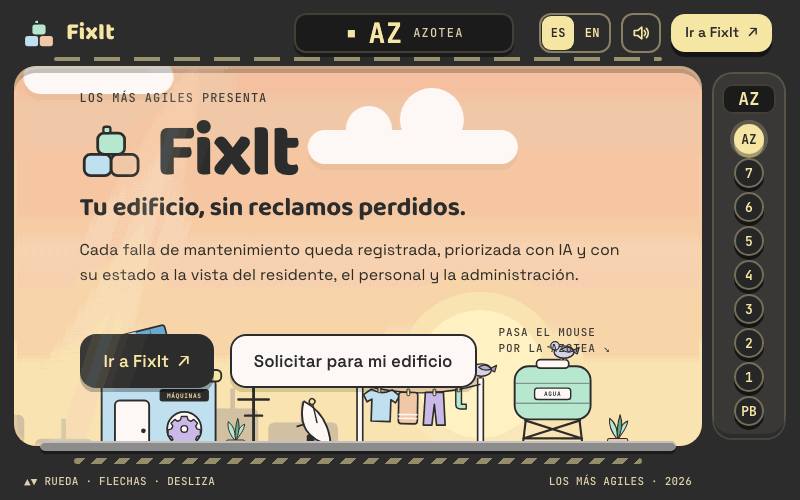

<sub>El ascensor baja de la azotea y cada piso se construye en vivo la primera vez que llegas.</sub>

</div>

---

## Contenido

- [El concepto: un viaje en ascensor](#el-concepto-un-viaje-en-ascensor)
- [Recorrido piso por piso](#recorrido-piso-por-piso)
- [Cómo se navega](#cómo-se-navega)
- [Idiomas (español / inglés)](#idiomas-español--inglés)
- [Accesibilidad y modo simple](#accesibilidad-y-modo-simple)
- [Tecnología](#tecnología)
- [Estructura](#estructura)
- [Correr en local](#correr-en-local)
- [Notas para el equipo](#notas-para-el-equipo)
- [Equipo](#equipo)

## El concepto: un viaje en ascensor

La página es **un edificio** y el visitante baja en un ascensor con vidrio, desde la **azotea** hasta la **recepción**.

- 🧱 **Cada piso se construye en vivo** la primera vez que se llega: ladrillo → tarrajeo → pintura → acabados → luz (~1,5 s), con efectos de sonido de obra.
- 🌇 **La hora avanza mientras se baja:** atardecer en la azotea, noche en el problema, amanecer y mañana hacia la recepción.
- 🔊 **Todo el sonido es sintetizado** en el navegador: no hay archivos de audio ni música.
- ✏️ **Todas las ilustraciones son SVG hechos en código**, con el mismo estilo *Modular Block City* de la app.

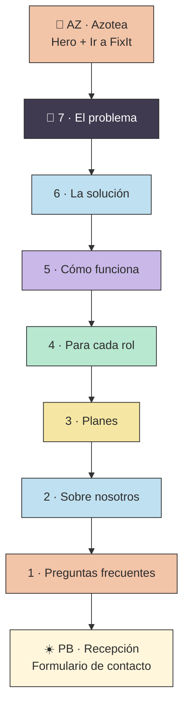

## Recorrido piso por piso

| Parada | Contenido |
|---|---|
| **AZ** · Azotea | Hero + "Ir a FixIt". Objetos interactivos: engranaje, antena, parabólica, tendedero, tanque y palomas |
| **7** · El problema | El chat del edificio que entierra el reclamo y un reloj que corre de viernes a lunes |
| **6** · La solución | Las 6 historias de usuario |
| **5** · Cómo funciona | De la falla a la solución en cuatro pasos + metas del proyecto |
| **4** · Para cada rol | Residente, mantenimiento y administración |
| **3** · Planes | Precios **referenciales** (se ajustarán al TF) |
| **2** · Sobre nosotros | El equipo |
| **1** · Preguntas frecuentes | Dudas comunes |
| **PB** · Recepción | Formulario de contacto + "Ir a FixIt" |

<table>
  <tr>
    <td width="50%">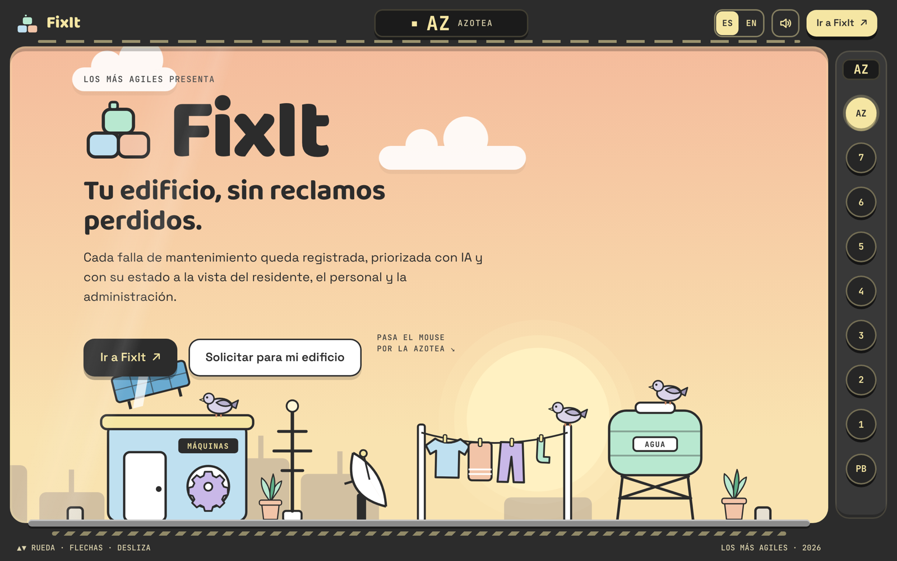<p align="center"><sub><b>Azotea</b> · atardecer y objetos interactivos</sub></p></td>
    <td width="50%">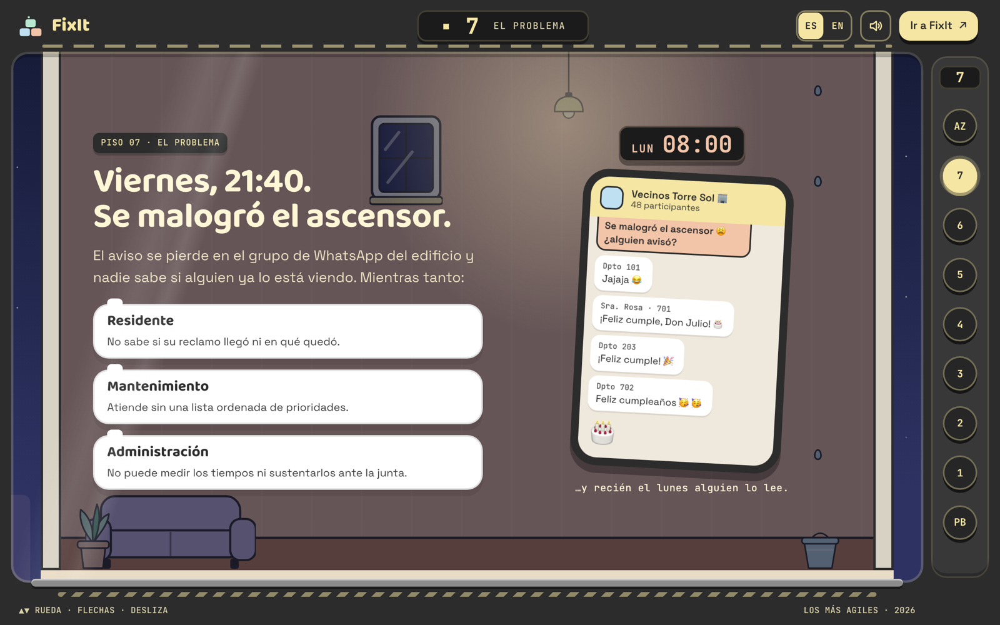<p align="center"><sub><b>Piso 7</b> · el reclamo se pierde en el chat</sub></p></td>
  </tr>
  <tr>
    <td>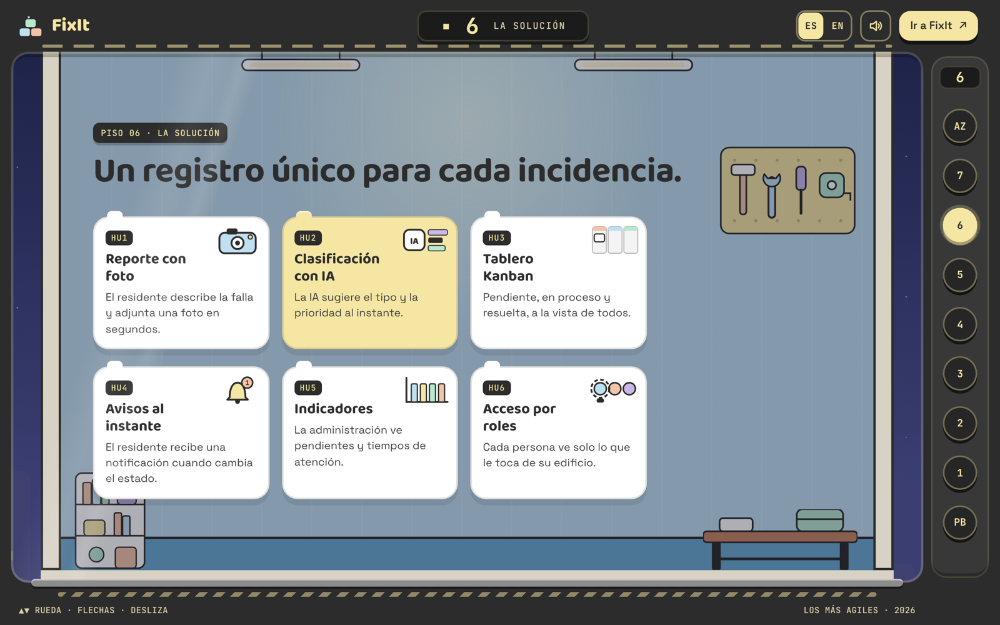<p align="center"><sub><b>Piso 6</b> · las 6 historias de usuario</sub></p></td>
    <td>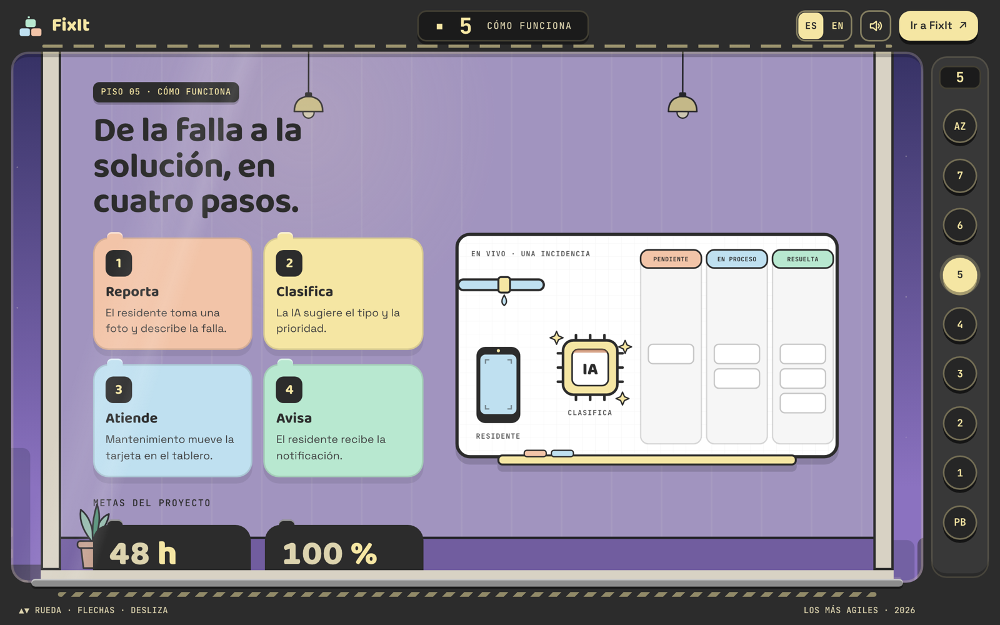<p align="center"><sub><b>Piso 5</b> · cómo funciona</sub></p></td>
  </tr>
  <tr>
    <td>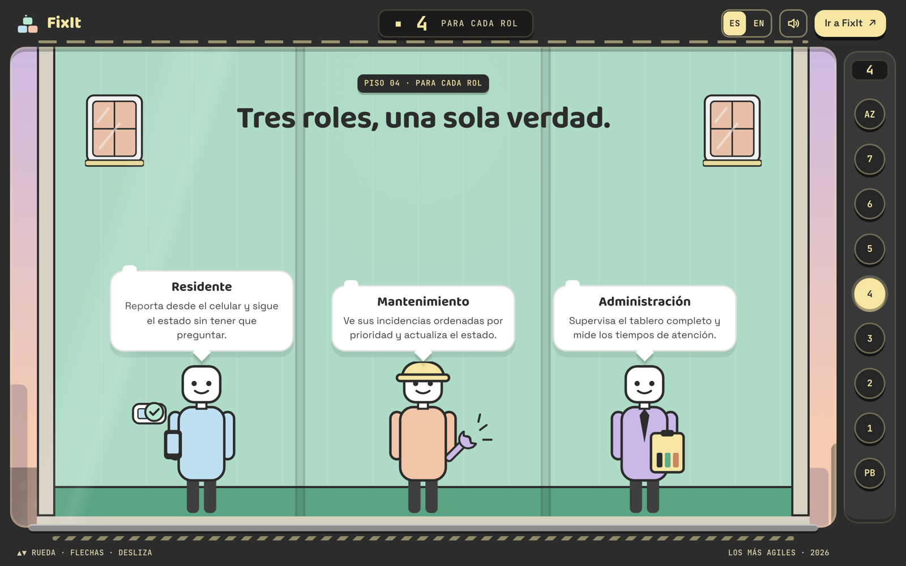<p align="center"><sub><b>Piso 4</b> · tres roles, una sola verdad</sub></p></td>
    <td>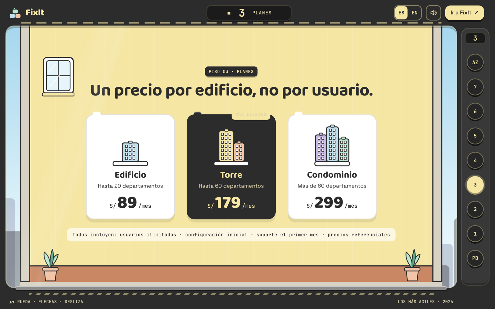<p align="center"><sub><b>Piso 3</b> · un precio por edificio</sub></p></td>
  </tr>
  <tr>
    <td>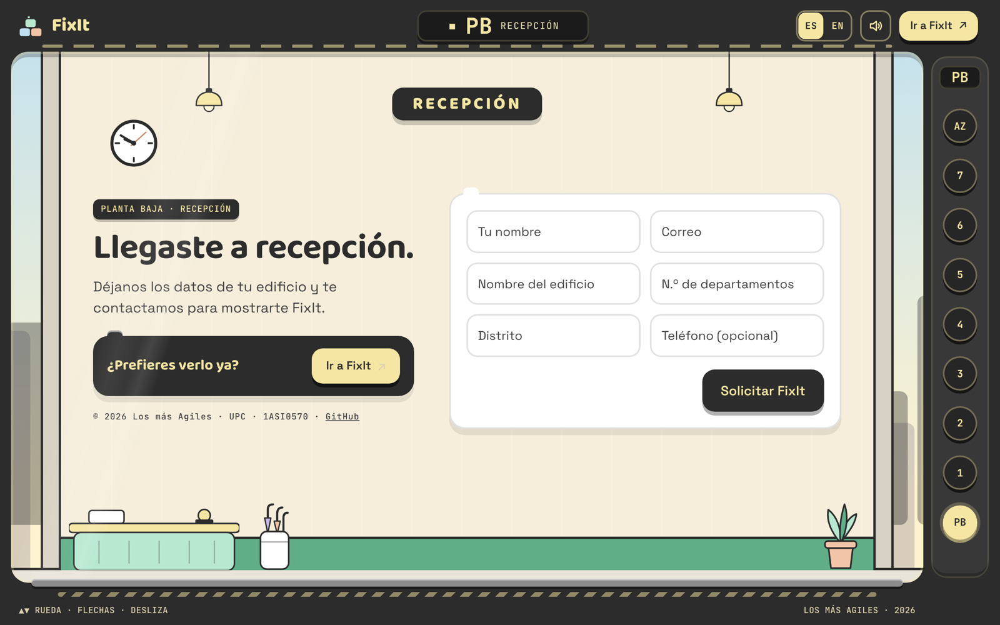<p align="center"><sub><b>Recepción</b> · formulario de contacto</sub></p></td>
    <td>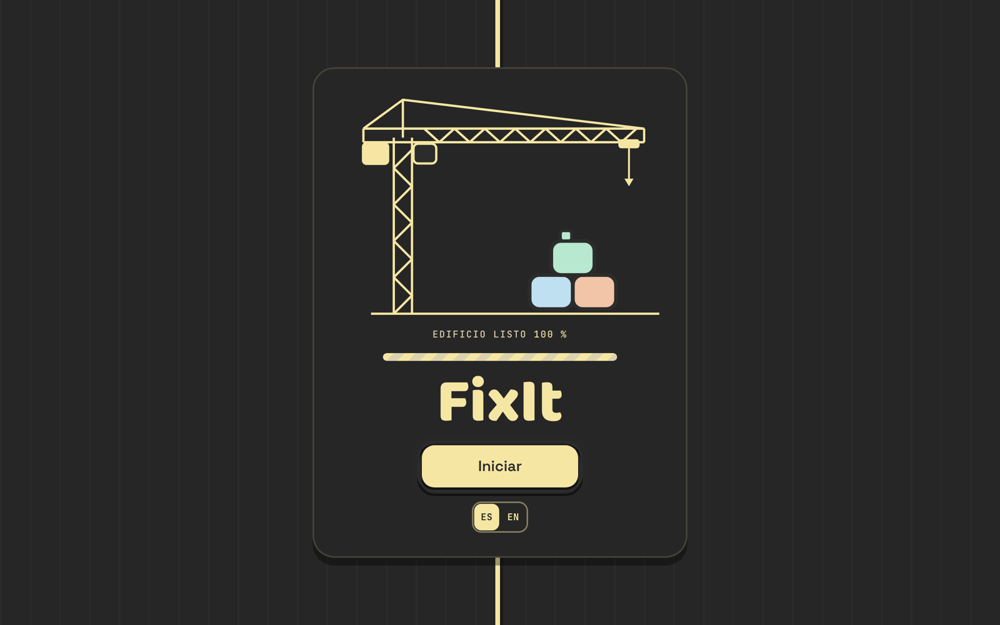<p align="center"><sub><b>Carga</b> · la grúa arma el logo y aparece <i>Iniciar</i></sub></p></td>
  </tr>
</table>

## Cómo se navega

| En la compu | En el celular |
|---|---|
| 🖱️ Rueda del mouse | 👆 Deslizar hacia arriba o abajo |
| ⌨️ Flechas ↑ ↓ | 🛗 Botón de la botonera en el techo |
| 🛗 **Botonera** a la derecha (se abre al pasar el mouse) | |

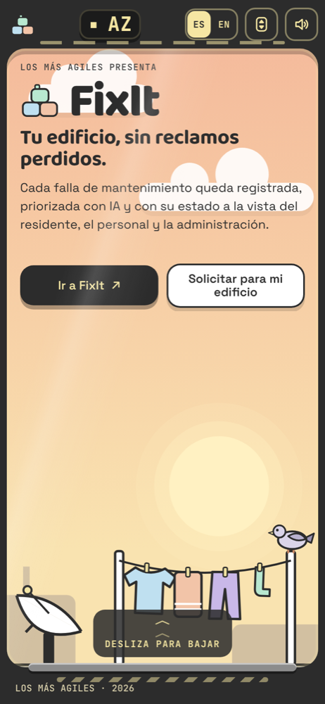

- Al terminar la carga aparece un único botón **Iniciar**: abre las puertas del ascensor y, como es un clic, también desbloquea el sonido (los navegadores no dejan reproducir audio sin un gesto de la persona).
- El sonido viene activado por defecto y se puede apagar desde el techo de la cabina.
- **Enlaces directos a un piso:** `#piso-3`, `#lobby`, etc.

<br clear="right"/>

## Idiomas (español / inglés)

- El HTML está escrito en **español**; `js/i18n.js` tiene el diccionario **español → inglés** y traduce solo los textos y atributos de la página.
- **Para agregar un texto nuevo** al HTML: sumarlo a `EN` en `js/i18n.js` con su traducción. Si no está, queda en español.
- Los textos que arma JavaScript (chat, reloj, errores del formulario, botonera, carga) se piden con `t('clave')` y se redibujan con el evento `idioma`.
- **Idioma inicial:** `?lang=en` en la URL → la elección guardada → el idioma del navegador. Se cambia con el selector ES/EN (en la carga y en el techo).

## Accesibilidad y modo simple

- Con **"reducir movimiento"** activado en el sistema, la experiencia no se apaga: solo se suaviza.
- **Sin JavaScript, con `?simple` en la URL o si algo falla al cargar**, la página se muestra como una web normal con scroll y todos los pisos ya construidos.
- Enlace "Saltar al contacto" para teclado, `aria-live` en el display del ascensor y textos de error del formulario conectados a cada campo.

## Tecnología

HTML + CSS + JavaScript puro, **sin paso de compilación**.

| | Pieza | Detalle |
|---|---|---|
| 🎞️ | [GSAP 3](https://gsap.com) | Observer, CustomEase y SplitText. Viene en `vendor/gsap`; si no carga, se pide a jsDelivr |
| 🔊 | Web Audio | Efectos de sonido **sintetizados** (`js/sonido.js`): no hay archivos de audio |
| 🎨 | Modular Block City | El mismo estilo que la app: `css/tokens.css` es copia de `FixIt-FrontEnd/src/styles/tokens.css` |
| ✏️ | SVG en código | Kit de piezas al inicio de `index.html` |

## Estructura

```
index.html        pisos, kit SVG, cabina, botonera y pantalla de carga
css/              tokens, base, cabina, pisos, azotea, carga
js/main.js        punto de entrada: asegura GSAP y carga app.js
js/app.js         arma la página-ascensor
js/ascensor.js    viaje entre pisos, cielo, display, botonera y controles
js/obra.js        motor de construcción de cada piso
js/escenas.js     animaciones propias de cada piso ya construido
js/azotea.js      objetos interactivos de la azotea
js/carga.js       pantalla de carga (grúa + puertas)
js/contacto.js    formulario (envío SIMULADO)
js/sonido.js      efectos de sonido
js/i18n.js        idiomas (diccionario ES → EN y función t)
js/ciudad.js      siluetas de la ciudad del fondo
vendor/gsap/      GSAP y sus plugins
docs/img/         capturas y GIF de este README
```

## Correr en local

Los módulos de JavaScript necesitan un servidor (no funciona abriendo el archivo con doble clic):

```bash
git clone https://github.com/Los-mas-agiles/FixIt-LandingPage.git
cd FixIt-LandingPage
python -m http.server 5510
```

y abrir <http://localhost:5510>. También sirve la extensión **Live Server** de VS Code.

## Notas para el equipo

- 📮 **El formulario no guarda nada:** valida, simula el envío y muestra el sello de "recibida". Cuando haya backend, reemplazar `enviar()` en `js/contacto.js` por un `fetch` a la API.
- ✅ **Validaciones del formulario:** nombre, correo, edificio y N.º de departamentos (entero de 1 a 999) son obligatorios; el teléfono es opcional, pero si se llena debe ser un celular peruano de 9 dígitos (acepta espacios, guiones y `+51`). Tiene una trampa invisible para bots.
- 💸 Los **precios** del piso 3 son referenciales.

## Equipo

**Los más Agiles** — UPC, 2026-2.

| Integrante |
|---|
| Jefrey Martin Sanchez Ignacio |
| George Arturo Aliaga Pimentel |
| Edery Renzo Abanto Vicente |

<div align="center">
<sub>Hecho con bloques 🧱 por Los más Agiles · <a href="https://github.com/Los-mas-agiles/FixIt-FrontEnd">FixIt-FrontEnd</a> · <a href="https://github.com/Los-mas-agiles/FixIt-BackEnd">FixIt-BackEnd</a></sub>
</div>
